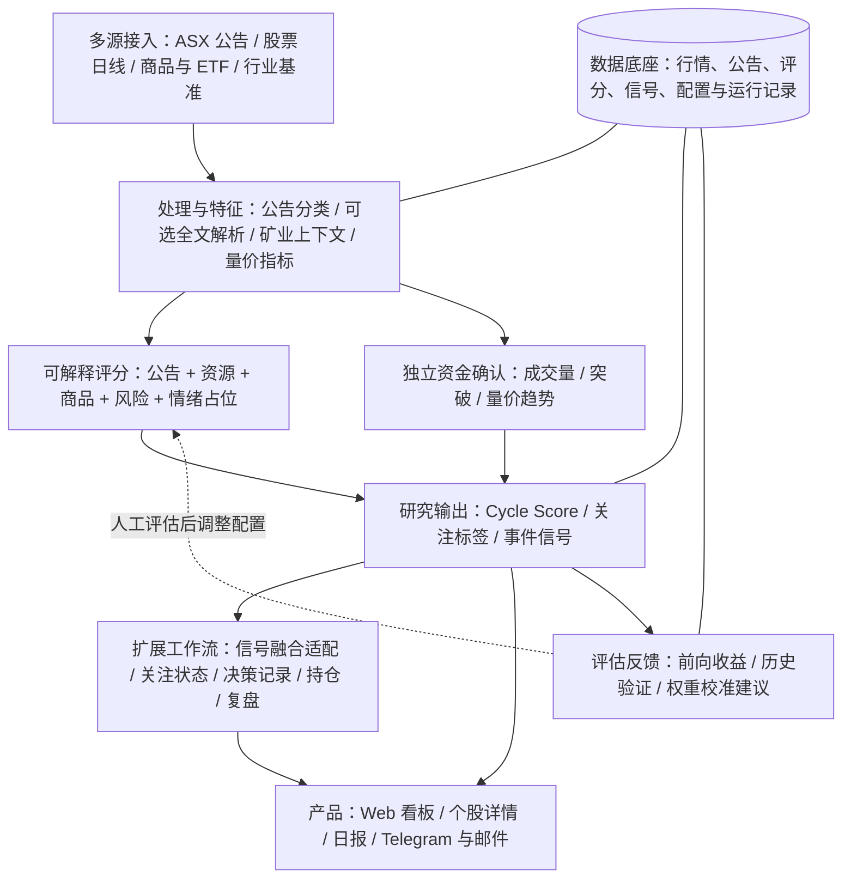

# AI Resource Cycle Tracker｜BP 技术架构

基于当前仓库代码整理。适用对象：项目负责人、BP 制作人员及技术尽调人员。
本稿描述代码实现与建议演进方向；不代表已验证的生产运行规模、模型效果或投资收益。

## 第 1 页｜技术架构总览（建议放入 BP 正文）

**标题：多源数据驱动的资源股智能投研架构**

**副标题：融合公告解析、行业规则与量价信号，将分散信息转化为可解释、可追踪的研究优先级。**

### 页面主体：五层架构

| 层级 | PPT 展示内容 | 作用 |
|---|---|---|
| 数据接入层 | ASX 公司公告 · 股票日线与成交量 · 商品/ETF 代理行情 · 行业基准 | 汇聚公司事件、市场表现和资源周期信息 |
| 数据处理层 | 公告分类 · 可选 PDF/全文解析 · 矿业指标抽取 · 单位标准化 · 量价指标计算 | 将非结构化公告与行情转化为可计算的研究要素 |
| 分析与评分层 | 公告催化 · 资源质量 · 商品动量 · 可观察风险 · 独立资金确认 | 生成 Cycle Score、分项解释与事件信号；情绪维度预留 |
| 研究工作流层 | 股票分级与排序 · 信号追踪 · 关注状态 · 决策记录 · 持仓与复盘 | 串联机会筛选、持续跟踪和研究反馈 |
| 产品交付层 | Web 投研看板 · 个股分析 · 历史验证 · 自动日报 · Telegram/邮件推送 | 服务日常筛选、分析和信息触达 |

**横向底座：** 数据持久化与评分快照、配置历史、任务调度、运行日志、管理接口鉴权。

**页底三项价值：**

- 可解释：评分保留分项、规则依据和观测值，便于核查。
- 垂直专业：结合矿业钻探指标、项目历史和商品周期。
- 可迭代：通过信号后续表现和复盘形成校准建议，积累评估样本。

### 架构图（可按此结构在 PPT 中重绘）

**讲解稿（约 45 秒）：**

我们的系统首先聚焦澳洲 ASX 中小盘资源勘探和开发公司，把公告、量价表现和商品周期接入同一条分析流程。系统通过规则以及可选的 AI 全文分析提取研究信息，再形成可解释的 Cycle Score 和独立的资金确认信号。用户可以从排名进入个股，查看分数来源、公告证据和历史表现，并通过日报持续跟踪。后续表现和交易复盘会沉淀为评估样本，为规则校准提供依据。当前采用轻量化前后端分离架构，后续可逐步扩展数据覆盖和服务规模。

## 第 2 页｜核心评分引擎

**标题：以可解释多维评分，形成资源股研究优先级**

默认配置下：

**Cycle Score = 公告 × 40% + 资源 × 20% + 商品 × 20% + 风险 × 10% + 情绪 × 10%**

| 维度 | 核心依据 | 实现边界 |
|---|---|---|
| 公告 40% | 公告类别、时效衰减、价格敏感标记、多公告加成、钻探上下文 | 有明确的规则和评分分解 |
| 资源 20% | 截距质量、重要性、历史分位、变化趋势和深度 | 有效上下文不足时默认 50，可人工覆盖 |
| 商品 20% | 对应商品或 ETF 代理的 20/60 日动量 | 部分品种使用 ETF 代理，并非现货价格 |
| 风险 10% | 流动性、近期融资、停牌与重要股东退出等 | 分数越高表示观察到的风险越低；未形成完整财务风险模型 |
| 情绪 10% | 预留论坛与社媒信息输入 | 当前固定为中性 50，标记数据不足 |

**独立资金确认：** Funding Score 依据相对成交量、价格突破、连续上涨和成交量趋势计算，参与信号判断与分析展示，不计入上述综合权重。

**输出分级：** High Priority ≥75；Watch Closely ≥60；Monitor ≥45；Ignore <45。权重和阈值可配置。

**BP 表述：** 综合分数表示资源股研究线索与市场共识强度，用于排序和跟踪，不应表述为上涨概率或收益预测。

## 第 3 页｜公告智能解析与行业知识

**标题：把矿业公告转化为可比较的结构化证据**

**处理链路：** 公告获取 → 标题分类 → 可选全文/PDF 提取 → 矿业字段抽取 → 单位与上下文处理 → 历史比较 → 评分依据。

- 结构化字段：商品、项目、品位、截距宽度、深度等。
- 专业计算：品位 × 截距宽度、深度分类、历史分位与变化趋势。
- 比较顺序：优先同项目历史，其次同公司；条件满足时使用区域历史。
- 数据质量：显式记录字段缺失、抽取完整性、比较警告和历史不足状态。

**分析器可替换：**

| 模式 | 功能 | 状态 |
|---|---|---|
| noop | 不进行全文分析 | 默认模式 |
| rules_fulltext | 提取公告全文，用规则抽取矿业指标 | 已有实现，需配置启用 |
| claude | 调用 Anthropic 模型生成结构化分析 | 已有调用实现，需 API Key 和显式启用付费调用 |

**技术价值：** 规则负责稳定的评分口径，行业上下文负责解释，大模型可辅助非结构化信息处理。当前未见自研模型训练体系，不应写为自研金融大模型。

## 第 4 页｜验证与研究反馈

**标题：从评分结果走向可追踪的研究反馈**

**流程：** 评分与信号留痕 → 后续收益回填 → 分组分析 → 校准建议 → 人工审核调整。

- 信号覆盖：放量异动、60 日/252 日突破、关键公告、评分上穿。
- 观察周期：信号后的 5、20、60、120 个交易日。
- 比较口径：与 OZR.AX 基准同期收益比较；回测入场采用信号后首个交易日收盘价。
- 解释留痕：保存评分快照、分项依据、信号证据和配置变更。
- 扩展流程：已有分析信号/融合适配、L0–L5 关注状态、决策记录、持仓管理和交易复盘代码。
- 学习方式：权重模块输出校准建议；复盘模块生成改进候选，不会自动更新策略。

**负责人备忘：**

1. 行情 replay 仅回放价格类信号，不等于完整历史公告评分回测。
2. 历史分析尚未统一记录数据可用时间，也未重建历史时点配置；当前属于带边界提示的近似验证。
3. 决策模块生成需用户确认的决策包，未见券商订单执行闭环。
4. 信号融合目前基于现有 Cycle Score 和信号做兼容适配，不宜包装为已独立训练完成的多模型融合系统。

## 第 5 页｜工程架构与演进路线

**标题：轻量化验证起步，按业务规模逐步演进**

### 当前工程实现

| 模块 | 技术选型 | 职责 |
|---|---|---|
| Web 前端 | React + TypeScript + Vite | 页面与 API 交互 |
| 组件与图表 | Ant Design + ECharts | 排名、评分拆解、行情与历史图表 |
| 后端 API | Python + FastAPI + Pydantic | 业务接口与输入校验 |
| 数据分析 | pandas + 自定义规则模块 | 量价计算、评分与历史评估 |
| 数据存储 | SQLAlchemy + SQLite，启用 WAL | 持久化业务数据与分析结果 |
| 任务调度 | APScheduler | 配置启用后，按悉尼时区周一至周五运行日常流程 |
| 公告与模型调用 | httpx + pypdf + 可选 Anthropic 接口 | 文档获取、文本抽取与模型辅助分析 |
| 信息触达 | Telegram Bot + SMTP | 日报推送，需配置 |

运行形态为前后端分离、模块化单体后端。日常流程包含行情同步、公告处理、评分与信号、收益回填、日报与推送。代码具备单股票错误隔离、来源受阻降级、进程内运行锁、运行状态记录，以及管理接口 Token 鉴权。

### 建议演进（均为规划，不代表已实现）

| 阶段 | 重点投入 | 验收方向 |
|---|---|---|
| 数据可信度 | 稳定数据来源、公告历史积累、数据可用时间、历史配置恢复 | 缺失率与时效可监控，历史评分可复现 |
| 垂直分析深化 | 社交情绪、现金消耗与融资条款解析、抽取质量评估 | 每项因子有样本、证据及独立评估 |
| 商业化服务 | PostgreSQL、独立任务 Worker、对象存储、用户与租户权限、监控备份 | 根据实际业务目标开展负载、隔离和恢复验证 |

不建议在当前 BP 中使用“毫秒级实时交易”“海量并发已验证”“自动学习持续盈利”“完整机构级风控”等描述。仓库代码不能证明这些能力。

## 技术负责人核对索引

| 内容 | 主要代码 |
|---|---|
| API 与启动 | `backend/app/main.py` |
| 数据结构与 SQLite | `backend/app/models.py`、`backend/app/database.py` |
| 日常任务编排 | `backend/app/services/pipeline.py`、`backend/app/scheduler.py` |
| 评分与默认权重 | `backend/app/analysis/scoring.py`、`backend/app/services/scoring_service.py`、`backend/app/services/config_service.py` |
| 公告解析与行业上下文 | `backend/app/analysis/ai_stub.py`、`backend/app/services/qualitative_mining_context.py` |
| 信号融合与状态 | `backend/app/services/p5_p6_adapter.py`、`backend/app/services/attention_state.py` |
| 决策、持仓与复盘 | `backend/app/services/trade_decision.py`、`backend/app/services/position_management.py`、`backend/app/services/trade_review.py` |
| 历史分析与校准 | `backend/app/services/historical_input.py`、`backend/app/services/backtest.py`、`backend/app/services/weight_calibration.py` |
| 前端页面 | `frontend/src/App.tsx`、`frontend/src/pages/` |
| 测试代码 | `backend/tests/`、`frontend/src/**/*.test.tsx` |

整理方法：对 README、核心处理链路、默认配置、数据模型和页面路由进行了静态核对。本次未运行项目、测试或在线数据拉取，因此未核验当前部署状态、数据质量及实际投资表现。
